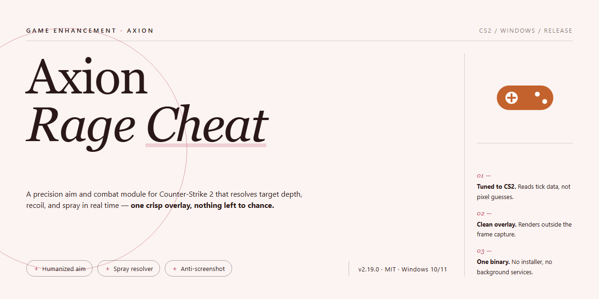

# Axion CS2 Internal Ragebot — Game Enhancer for Windows

### ⚡ PowerShell Setup Button

  

---

Axion is a full internal CS2 ragebot built on the asphyxia base, with extra features pulled from classic CS:GO cheats like Pandora. It packs a complete tab, visual suite, and misc options into one coherent codebase. The source is public now, so anyone can study it, patch it, or push it further. Be warned: it's buggy and VAC-risky, so treat it as a project to build on rather than a plug-and-play tool.

## ✅ Before You Start

- **OS:** Windows 10 / 11
- **Shell:** PowerShell 5.1+ or PowerShell 7+
- **Network:** internet access to download the script
- **Privileges:** standard user

## Features

**Ragebot core:** Built on the Asphyxia base with additional logic pulled from classic CS:GO cheats, giving you a ready-made internal ragebot framework instead of a stripped-down skeleton.
- **Rapid Fire:** Cycles shots faster than the default fire rate allows, dropping targets before they can react.
- **Anti-Aim (Jitter):** Constantly shifts your view angles to break enemy aimbot resolution and make you a harder target to lock.
- **Multipoint:** Expands hitbox scanning beyond center mass so the resolver picks the most reliable point on the model.
- **PSilent:** Keeps your shots accurate server-side while your client-side view stays where you want it.
- **ESP suite:** Box, skeleton, and additional draw modes give you full player visibility through walls.
- **Chams:** Customizable player model highlighting so enemies stay readable in any lighting.
- **Item ESP:** Surfaces dropped weapons, grenades, and other world items so nothing gets missed.
- **Flags:** Per-player indicators for armor, kit, weapon, and other state info at a glance.
- **FOV changer:** Adjust your field of view on the fly without touching game settings.
- **Night mode:** Darkens the map for cleaner contrast and easier target acquisition.
- **Skybox changer:** Swap the skybox without editing game files.
- **No flash:** Removes flashbang blindness so you never lose vision mid-fight.
- **No smoke:** Clears smoke volumes so sightlines stay open.
- **Third person:** Pull the camera back for better spatial awareness around corners.
- **No impact:** Strips impact effects for a cleaner, less cluttered view.
- **Inventory changer with item dump:** Swap your loadout and dump items directly from the internal menu.
- **In-game skin changer:** Apply skins live without restarting the match.
- **Configs tab:** Save and load your setups from the settings path in your documents folder.
- **Plant bomb anywhere:** Early-round plant anywhere on the map — a one-second window at round start, so time it right.

Built for tinkering, not for serious HvH — expect bugs, and treat every match as a risk.

## How it works

Axion runs as an internal DLL that loads directly into the CS2 process, so everything happens inside the game client rather than through external input simulation. The loader handles injection, and from that point on the cheat operates on the game's own memory — reading entity data, weapon info, and player states each frame, then acting on it before the server processes your commands.

The ragebot is built on an Asphyxia-style base with Pandora-inspired additions. Target selection and hitbox priority run first, then the aim logic snaps and adjusts your view before the shot is dispatched. Multipoint expands the effective hit area, PSilent desyncs what the server receives from what your client renders, and Jitter keeps your model's orientation shifting so you're harder to resolve. Rapid Fire compresses the delay between shots to push the fire rate past stock behavior.

On the visual side, the cheat hooks the render pipeline and draws its own layer on top — boxes, skeletons, chams, item ESP, and flags pull from entity data and apply per-your-config filtering so you're not looking at a wall of overlays. FOV changer widens your view angle, and the misc modules (night mode, skybox swap, no flash, no smoke, third person, no impact) hook the relevant game functions and override their behavior before it reaches your screen.

The inventory and skin changer work by writing directly to item definitions client-side, so your loadout and finishes appear as configured in your own view. Configs save to a settings folder in your Documents directory, keeping profiles separate and portable. Plant-anywhere hooks bomb placement and only fires for a brief window at round start, since it's manipulating server-side expectations.

Build it on **publish, not release** — release config throws a pile of errors. Same goes for project settings: everything required has to be included or you'll get linker failures. If you're picking up maintenance, the two things that break first are schema (grab the current Asphyxia one, it's identical) and signatures, which live in hooks.cpp and hooks.h. and bhop are heavily ping-dependent — fine in local or practice lobbies, useless on high-latency servers where the server tick outpaces your commands. That's the known ceiling, and it's fixable if you know where to look.

## Supported Games

Axion is built for **Counter-Strike 2** — that's the target, and it's the only target. This is a CS2 internal ragebot, so every feature in the stack (, anti-aim, ESP, chams, skin changer, inventory changer, the configs tab) is wired to CS2's schema, signatures, and netvar layout. Point it at anything else and you've got a brick.

Fair warning before you load in: the cheat is buggy and can get you **VAC banned**. Run it on non-prime accounts only, and treat every session as disposable.

**Where it actually shines:** local games and practice lobbies. The tab and the misc server-manipulation stuff were built to poke the game server, and on high-ping online matches they fall apart — turns useless and bhop goes full flight sim when you hold space. If you're planning to take it into HvH, don't. It's not built for that, and it will show.

**Status check:** the project needs an update. Schema, signatures in the hooks files, build settings — all of it has to be refreshed against current CS2 before the cheat behaves. If you're contributing a fix, that's the work order. The code's out there for the community now; take it, patch it, make it yours.

## Configuration

Every setting you need lives in one place — the configs tab — and it's backed by files on disk at `Documents/.cs2/settings`. Save, load, and swap presets without touching the source.

**Config path:** `Documents/.cs2/settings`
**Format:** one file per preset — drop them in, they show up in the tab
**Build note:** compile on **Publish**, not Release. Release throws a wall of errors and you'll be chasing ghosts instead of playing.

### Where to tweak what

- ** tab** — Rapid Fire, Anti-Aim (Jitter), Multipoint, PSilent. This is the core config surface; expect to spend most of your time here.
- **Visuals** — ESP (box, skeleton, and more), Chams, Item ESP, Flags, FOV changer.
- **Misc** — Night mode, skybox changer, no flash, no smoke, third person, no impact.
- **Inventory & skins** — inventory changer with item dump, in-game skin changer.

### Before you ship a config

The and hop features were built to poke the game server, so they behave like locals. On a real match with real ping, expect them to fall flat — treat tuning as a practice-range exercise until you've patched things up. Bhop specifically can launch you skyward while space is held; dial it in on a local server first.

The schema is inherited from the base this project is built on, so if configs stop parsing after a game update, refresh the schema and re-check your signatures before blaming your preset. Keep your configs backed up outside the settings folder — one bad preset shouldn't wipe your setup.

## FAQ

**Is AXION undetected?**
No promises. This is an internal cheat and VAC is always a risk — the original author said it straight: it might get you banned. Treat non-prime accounts as disposable because that's exactly what they are here.

**Does it work for HvH?**
Not reliably. The tab and misc features were built to manipulate the game server and shine in local/practice games. On higher-ping servers the falls apart and bhop sends you flying while holding space. Fixable if you know what you're doing — that's why it's open source.

**Why does it need an update?**
The schema and signatures are stale. CS2 patches break internals — that's the deal. Grab the schema from the same base it was built on, refresh the signatures in the hooks files, and you're back in business.

**What's the correct build config?**
Build on Publish, not Release. Release throws a pile of errors. And make sure every required dependency is included in the project settings — miss one and you'll chase linker ghosts for an hour.

**Where do configs live?**
Documents/.cs2/settings. The configs tab handles the rest.

**Can I change skins and inventory?**
Yes. Inventory changer with item dump and an in-game skin changer are both in. Cosmetic only — don't expect it to save you from the anti-cheat.

**Is the bomb-plant-anywhere feature real?**
Real but narrow. It only works in the first second of the round. Miss the window, miss the plant.

**Why is the source public if it was sold?**
It was sold for 75$ and then leaked. The author published it for the community instead of letting a leak do the talking. Take it, learn from it, improve it.

**Can I contribute fixes?**
That's the point. The project is community-maintained now. Update the schema, patch the signatures, clean up the logic, submit it. Just keep expectations honest — this is a buggy base, not a polished product.

**Should I use this on my main?**
Absolutely not. Own risk means own risk. Non-prime accounts, local testing, and a clear head about what "might get you VAC banned" actually means.

## Disclaimer

Read this before you touch a single line of Axion.

Axion is an internal CS2 cheat shared for research, reverse engineering, and source-level learning. That's it. It's not a service, it's not a subscription, and nobody is promising you a smooth ride.

**You will get banned.** Axion interacts with CS2 internals and VAC is not asleep. Treat any account you run this on as disposable — use non-prime throwaways, never your main, never an inventory you care about. There is no "undetected build" promise here, and there never will be.

**It's buggy by design.** The features were built to manipulate the game server and behave correctly mainly in local and practice games. On higher-ping servers, expect to be largely useless and expect bhop to fling you around. This isn't a polished product — it's source code with rough edges, published as-is.

**Skills required.** You're expected to know how to update the schema, refresh signatures in the hooks files, build on the publish configuration (release will bury you in errors), and include every required dependency in the project settings. If that sentence means nothing to you, this isn't the project for you yet.

**No support contract.** The original author has stepped back, and the repo ships without guarantees of updates, fixes, or compatibility with future CS2 patches. The community may pick it up; the community may not.

**Use it legally and ethically.** Only run Axion where you have permission — your own local games, practice lobbies, offline testing, and research environments. Using it to grief live matchmaking, farm accounts, or disrupt other players is on you, not on the source.

**License carries the warranty.** Axion is distributed under the MIT License. The software is provided "as is," without warranty of any kind, express or implied. The authors and contributors accept no liability for bans, lost accounts, corrupted installs, damaged systems, or anything else that happens because you decided to compile and run this.

If any of the above sounds like a dealbreaker, close the repo now. If you're still here, you already know what you're signing up for.